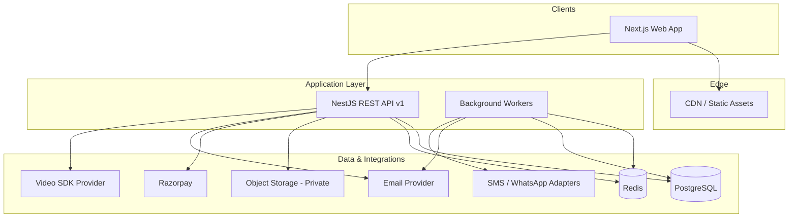

# MediConnect — Product Architecture Overview

## Vision

MediConnect is a multi-tenant healthcare SaaS platform connecting patients, doctors, and clinics in India (with international expansion hooks). Revenue comes from doctor/clinic subscriptions, optional appointment commissions, and value-added features—not from advertising or selling patient data.

## High-Level Architecture

## Architectural Principles

1. **Backend as source of truth** — All authorization, booking rules, payments, and clinical access enforced in NestJS; Next.js is a UI and BFF-style client only.
2. **Tenant isolation** — Clinic/org data scoped by `tenantId`; queries always filter by tenant membership unless platform-admin metadata endpoints.
3. **Least privilege** — Roles + resource-level permissions; super-admin does not bulk-read PHI without audited break-glass flows (future).
4. **Idempotent side effects** — Payments webhooks, notifications, and job handlers use idempotency keys.
5. **Auditable clinical changes** — Append-only or versioned records for prescriptions and finalized notes (Phase 4+).
6. **Provider abstraction** — Payments, email, SMS, storage, and video behind interfaces.

## Deployment Units

| Unit | Responsibility |
|------|----------------|
| `apps/web` | Public site, dashboards, SSR/CSR UI |
| `apps/api` | REST API, webhooks, scheduled jobs entry |
| `packages/database` | Prisma schema, migrations, seed |
| Worker (Phase 7) | Same NestJS app or separate process consuming Redis queue |

## Multi-Tenancy Model

- **Platform tenant** — Global config, plans, specialties catalog.
- **Clinic tenant** — Each clinic (or clinic group) is a tenant; branches belong to tenant.
- **Doctor** — May belong to multiple clinics via memberships; availability and appointments are branch-aware.
- **Patient** — Global user account; care relationships and record access via appointments and explicit care-team links.

## Time & Locale

- Store timestamps in UTC (`timestamptz` in PostgreSQL).
- User/clinic timezone on profile; slot generation uses clinic/doctor timezone with explicit conversion at API boundaries.
- Default locale `en-IN`; currency INR for MVP.

## Compliance Posture (Non-Legal)

Features support DPDP-oriented consent, retention, and deletion workflows. Telemedicine and clinical record rules vary by state and specialty—**legal review required** before production claims. See `docs/architecture/09-risks-and-assumptions.md`.
